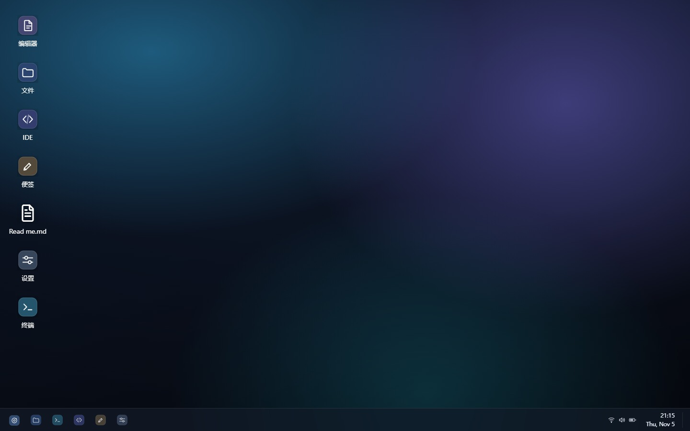
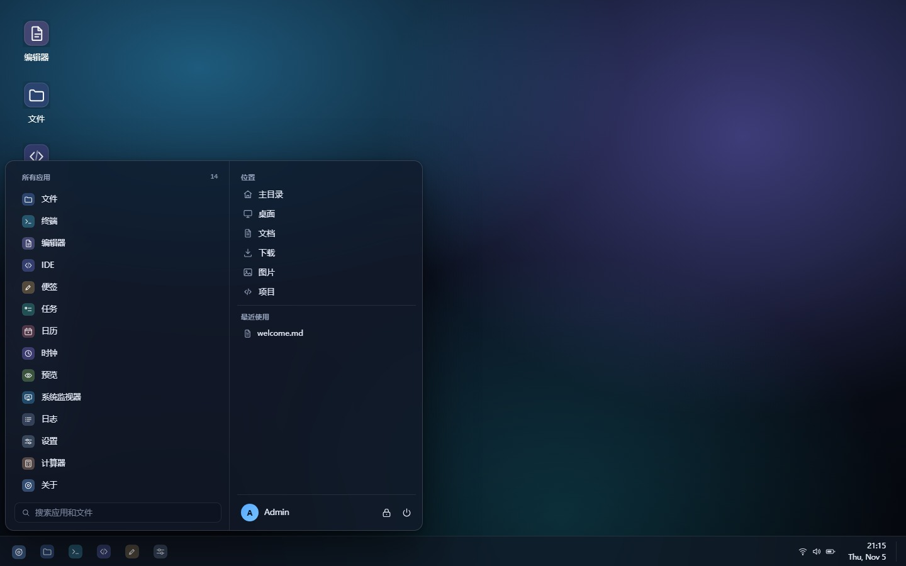
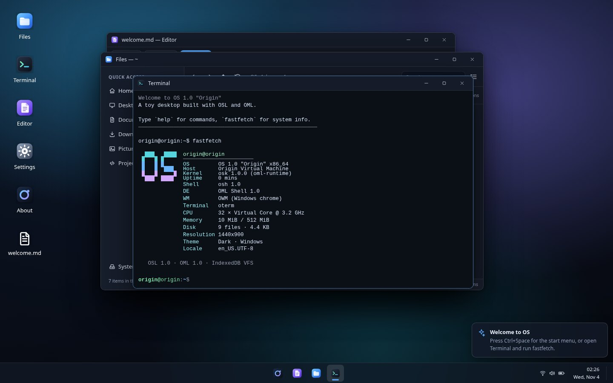
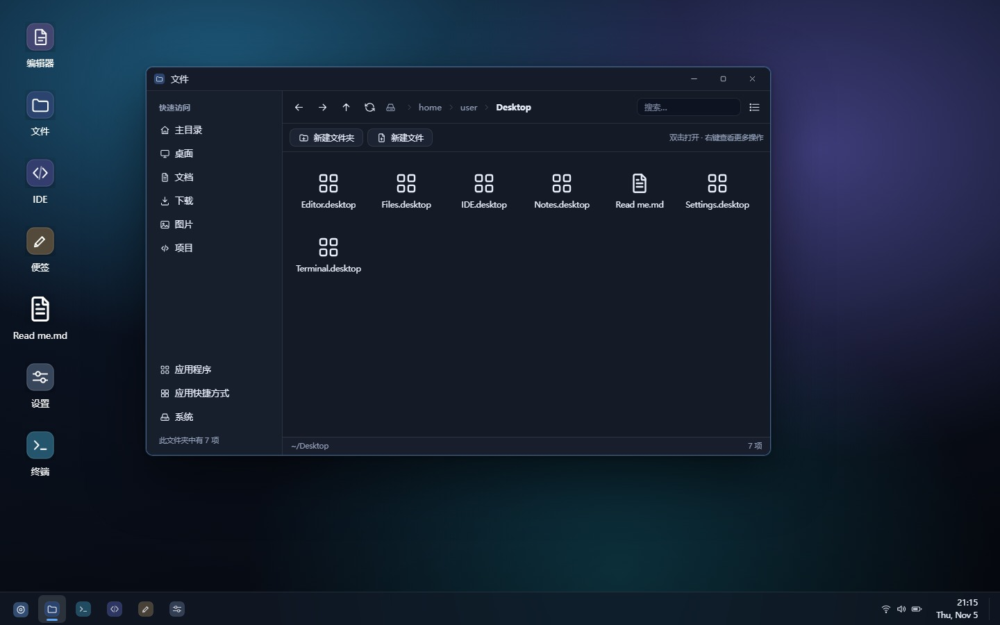
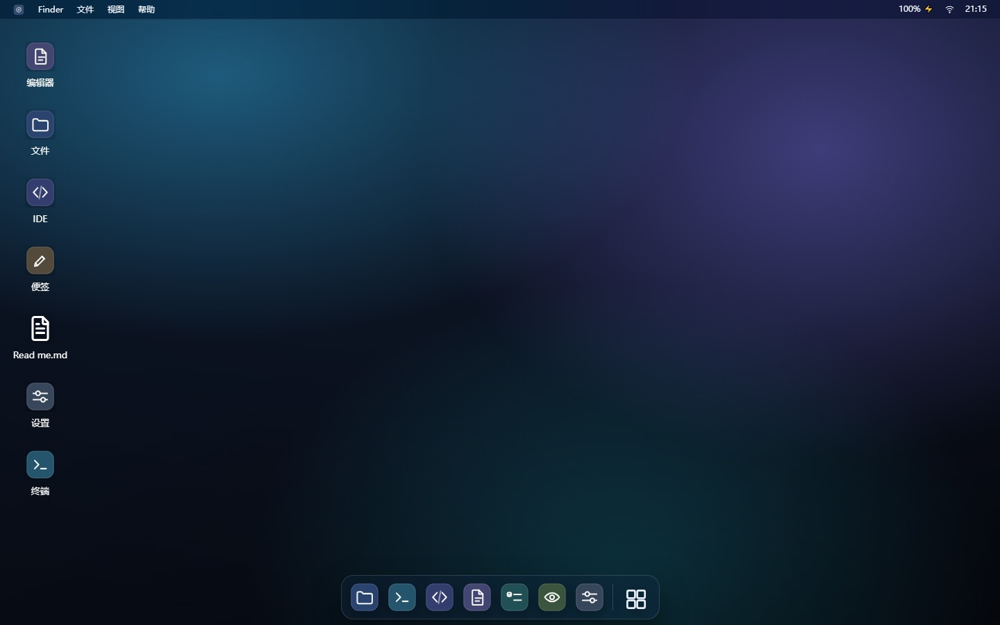
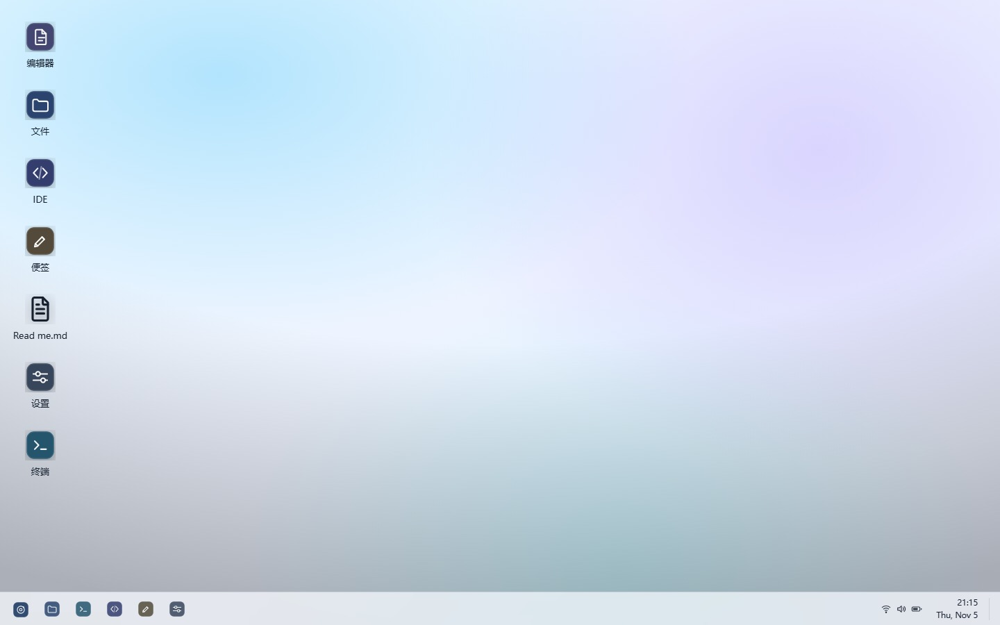
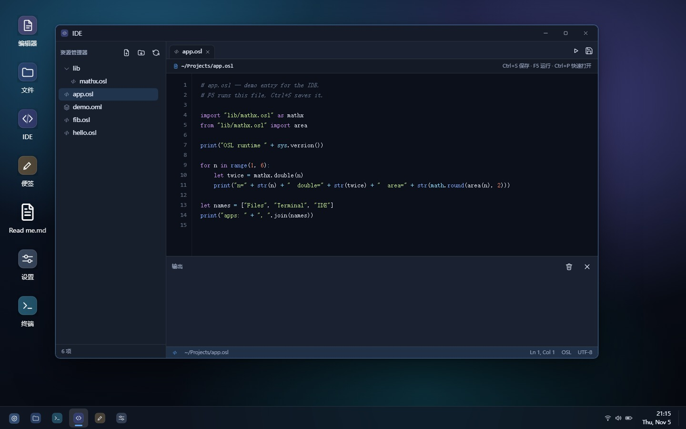
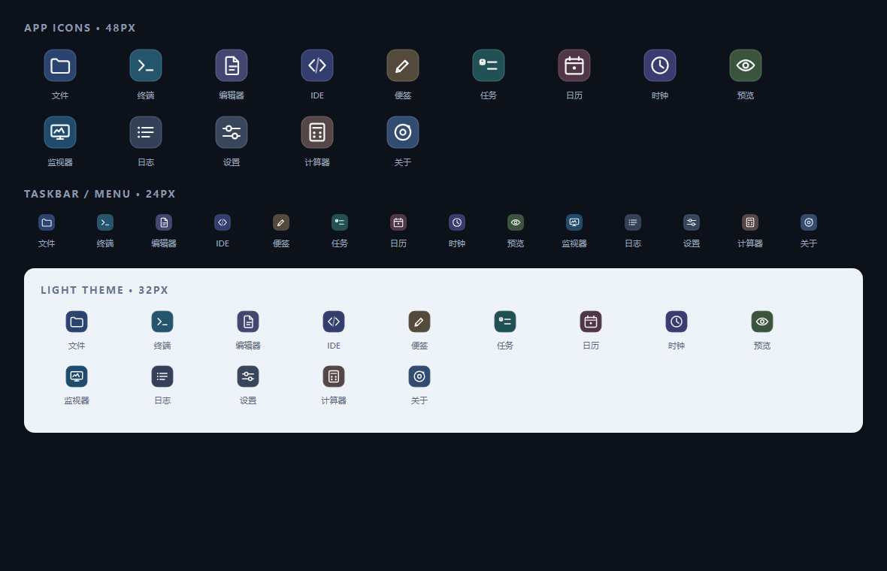
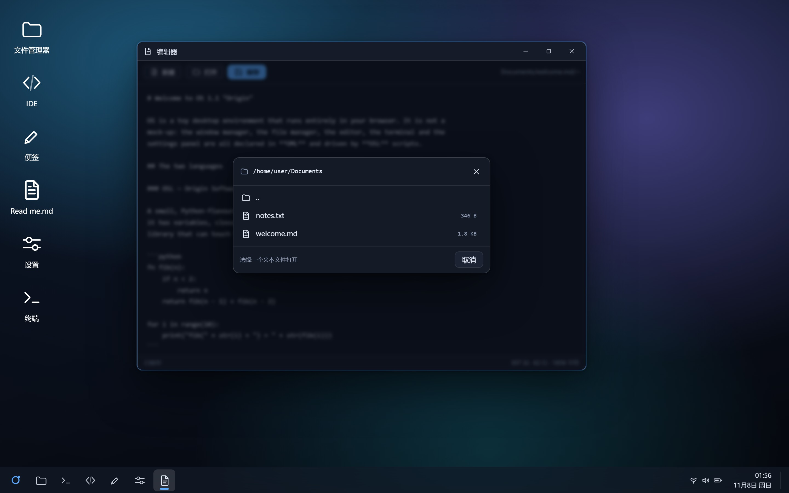

# OS 1.1 "Origin"

一个运行在浏览器里的玩具桌面系统。窗口管理、文件管理器、编辑器、终端、设置面板
**全部**由两门自制语言写成：

| 语言 | 全称 | 作用 | 类比 |
| --- | --- | --- | --- |
| **OSL** | Origin Software Language | 缩进敏感的脚本语言，驱动所有交互逻辑，支持多文件模块 | Python |
| **OML** | Origin Markup Language | XML 方言，描述所有界面结构与样式 | XAML / WPF |

宿主（TypeScript）只提供三样东西：语言解释器、渲染器、系统调用。界面上没有一个
写死的按钮 —— 连任务栏、开始菜单、macOS 菜单栏、Dock 都是 `shell.oml` 里的标签。

```bash
npm install
npm run dev      # http://127.0.0.1:5173
npm run build    # tsc --noEmit && vite build
npm run preview
```

## 截图

| 桌面（Windows 风格） | 开始菜单 |
| --- | --- |
|  |  |

| 终端 + fastfetch | 文件管理器 |
| --- | --- |
|  |  |

| macOS 风格（菜单栏 + Dock） | 浅色主题 |
| --- | --- |
|  |  |

| IDE（语法高亮 + 运行输出） |
| --- |
|  |

## 图标系统

所有应用图标共用一套网格：48×48 画布、12px 圆角、统一的深色底与 2.2px 白色线性图形，
只用 20% 左右的应用色偏做区分。





---

## 功能一览

- **窗口管理**：拖拽、八向缩放、边缘吸附（左/右半屏、最大化）、最大化/还原、
  最小化、z-order、Alt+Tab 切换器（含预览卡片）、级联摆放。
- **两套外观**：`body[data-style="win"]` 是 Windows 任务栏 + 开始菜单；
  `data-style="mac"` 换成菜单栏 + Dock + 交通灯按钮。同一份 OML，只靠 `if` 切换。
- **文件系统**：内存 B 树同步读 + IndexedDB 异步镜像写（40 ms 批量 flush），
  预置 `/etc`、`/home/user/Documents`、示例 `.osl` / `.oml` 文件。
- **终端**：管道 `|`、重定向 `>` `>>` `<`、`&&` `||` `;`、`$VAR` 展开、Tab 补全、
  历史持久化、ANSI SGR 配色，45+ 条命令，含 `fastfetch`。
- **应用**：Files、Terminal、Editor、IDE、Notes、Tasks、Calendar、Clock、Preview、
  Monitor、Logs、Settings、Calculator、About —— 每个应用都是一对 `.oml` + `.osl` 文件。
- **多语言**：中文 / English 界面，词条集中在 `src/i18n`，设置面板可切换。
- **桌面即文件系统**：`~/Desktop` 下的文件就是桌面图标，`.desktop` 是快捷方式。
  图标可以拖到桌面任意位置，坐标写入 `~/.config/desktop-layout.json`；右键「整理图标」复位。
- **运行窗口**：`Alt + F2`、开始菜单或桌面右键都能打开 Run，按应用名（中英文皆可）
  或路径启动；带过滤建议，回车运行、Esc 关闭。
- **应用注册表**：`/etc/apps.json` 保存应用列表与元数据（名称、图标、窗口大小、是否隐藏），
  每个应用的目录里还有 `app.json`。改完调用 `sys.reloadApps()` 即可生效。
- **系统源码全在文件管理器里**：每个内置应用以 `.oml` + `.osl` 放在
  `/usr/share/apps/<app>/`，外壳自身在 `/usr/share/os/`（`shell.osl`、`shell.oml`、
  `dialog.oml`、`menu.oml`），语言包在 `/usr/share/i18n/`，启动项在
  `/usr/share/applications/`。文件管理器侧栏都有对应入口。
- **任务栏 / Dock**：Windows 任务栏支持固定应用（右键开始菜单或任务栏按钮），
  同一应用的多个窗口会合并成一个按钮并显示数量，点击在窗口之间循环切换；
  固定按钮可以拖动排序。macOS Dock 同样可增删固定项，并把最小化窗口收进 Dock。
- **多窗口**：同一个应用可以开任意多个窗口，开始菜单每次点击都会新建一个，
  中键点击任务栏/Dock 图标也可以新建；窗口入口在任务栏/Dock 里按应用分组并显示数量。
  鼠标悬停分组按钮会弹出窗口预览列表，点条目切换，预览里也能直接新建窗口。
- **真实系统状态**：电量通过 `navigator.getBattery()` 读取，音量是可调的系统音量
  （影响通知提示音），托盘面板里可以直接调节。
- **壁纸**：8 套深色壁纸各自有浅色版本；还可以上传本地图片作为自定义壁纸。
- **桌面网格**：右键「对齐到网格」是可切换的开关——开启时拖放会吸附到网格，
  关闭后图标可以随便放；设置里也有同一个开关。
- **语言包是数据**：中文词条在 `src/i18n/zh.json`，运行时写入
  `/usr/share/i18n/*.json`；OSL 可以 `json.parse(fs.read(...))` 读取、修改后
  `i18n.reload()` 立即生效。
- **窗口动画**：最大化/还原有 0.2 秒过渡，最小化会缩小飞向任务栏按钮或 Dock 图标。
- **模块化 OSL**：`import "lib/x.osl" as x` / `from "lib/x.osl" import y`。

---

## 目录结构

```
src/
  osl/            OSL 语言实现
    lexer.ts        缩进敏感分词（INDENT / DEDENT）
    parser.ts       递归下降语法分析 → AST
    interp.ts       树遍历解释器（作用域、闭包、类、异常、切片）
    builtins.ts     fs / paths / sys / ui / win / time / math / json / store / clip
    host.ts         宿主能力接口（窗口、内核、UI 回调）
  oml/            OML 实现
    parser.ts       XML 方言解析（属性、自闭合、注释、实体）
    widgets.ts      标签 → DOM 组件 + 布局属性
    renderer.ts     UiInstance：挂载、绑定、For 列表、全量刷新
    overlay.ts      对话框与右键菜单（本身也是 OML）
  core/
    fs.ts           VirtualFS（Map + IndexedDB 镜像）
    wm.ts           OWM 窗口管理器（含最小化动画目标解析）
    kernel.ts       内核：启动 shell、托管应用、通知、快捷键
    settings.ts     主题 / 壁纸 / 强调色 / 用户
  system/
    shell.oml       整个桌面（菜单栏、图标、任务栏、Dock、通知、开始菜单）
    shell.osl       桌面逻辑（时钟、图标拖拽、固定项、托盘、菜单）
    dialog.oml      通用对话框
    menu.oml        右键菜单
  apps/<app>/     每个应用一对 .oml + .osl
  i18n/           语言包（英文原文为键，中文词条在 locales 中）
  shell/
    commands.ts     终端命令表
    terminal.ts     终端仿真（解析、作业控制、ANSI → HTML）
  styles/         base / shell / apps / terminal 四份 CSS
  assets/icons/   64 个线性 SVG 图标 + 7 个彩色应用图标
```

---

## 启动链路

```
main.ts
  ├─ SettingsStore.load()       读取 localStorage 主题
  ├─ Vfs.init()                 挂载 IndexedDB，种下初始目录树
  ├─ Kernel.boot()
  │    ├─ Interpreter 跑 shell.osl     → 定义 tickClock / launch / menuItems…
  │    ├─ UiInstance 挂载 shell.oml    → 生成桌面 DOM
  │    └─ installShortcuts()          → Alt+Tab / Alt+F4 / Ctrl+Alt+T…
  └─ 首次运行打开 welcome.md 并弹通知
```

`Kernel.open(appId)` 为每个窗口新建一套 `Interpreter` + `UiInstance`，所以两个
编辑器窗口的 `path`、`text` 变量互不干扰。

---

## 语言文档

完整语法、内建函数、模块系统与 OML 组件参考见 **[docs/](docs/README.md)**，
按主题拆成多个文件。

## OSL 语言参考

缩进敏感（4 空格或 Tab），`#` 注释，语句结尾不加分号。

### 变量与运算

```osl
let name = "origin"
let count = 0
count += 1
let ratio = 1.5
let ok = True and not False
let text = f"{name} has {count} file"
```

支持的运算符：`+ - * / % **`、`== != < <= > >=`、`and or not`、`&& || !`、`in`、
`not in`、`is`、`is not`、两种三元 `a if cond else b` 与 `cond ? a : b`、
索引与切片 `lst[1:3]`。

### 函数与闭包

```osl
fn greet(who, punct = "!"):
    return "hello " + who + punct

fn counter():
    let n = 0
    return fn():          # 匿名函数（也可写 x => x * 2）
        n += 1
        return n

let c = counter()
print(c())                # 1
print(c())                # 2
```

### 控制流

```osl
if score > 90:
    print("A")
elif score > 80:
    print("B")
else:
    print("C")

for i in range(3):
    print(i)

for key, value in {"a": 1, "b": 2}:     # 字典遍历
    print(key + "=" + str(value))

for index, item in enumerate(items):
    print(str(index) + ": " + item)

while n < 10:
    n += 1
```

### 类

```osl
class Point:
    fn init(x, y):        # 构造函数；self 自动注入
        self.x = x
        self.y = y

    fn length():
        return math.sqrt(self.x * self.x + self.y * self.y)

let p = Point(3, 4)
print(str(p.length()))    # 5
```

### 异常

```osl
try:
    raise "disk full"
except e:
    print("caught: " + e)
finally:
    print("done")
```

### 内建函数

`print` `len` `range` `str` `int` `float` `bool` `type` `sum` `min` `max` `abs`
`round` `sorted` `reversed` `enumerate` `zip` `map` `filter` `any` `all` `chr`
`ord` `eval` `sleep` `every` `notify` `open` `uuid` `refresh`

### 标准库

| 命名空间 | 方法 |
| --- | --- |
| `fs` | `read write append list mkdir remove rename copy exists isDir stat size count cwd home normalize sizeText readJson writeJson touch` |
| `paths` | `join dirname basename extname normalize split home relative` |
| `sys` | `open openPath apps windows focusWindow minimizeWindow closeWindow notify settings setSetting version uptime user hostname touchRecent recent platform arch info factoryReset notifications dismissNotification minimizeAll lock power` |
| `ui` | `refresh alert confirm prompt toast menu` |
| `win` | `setTitle close minimize maximize restore toggleMax setSize isMaximized id` |
| `time` | `now format date year` |
| `math` | `pi e floor ceil round abs sqrt pow min max random randint sign` |
| `json` | `parse stringify` |
| `store` | `get set remove`（localStorage） |
| `clip` | `read write` |
| `console` | `log warn error`（写入终端） |

时间格式化占位符：`YYYY YY MMMM MMM MM DD dd d dddd ddd HH hh mm ss A`。

### 一段完整的 OSL

```osl
# 列出 Documents 下的文件，按名称排序
fn walk(dir, depth):
    let out = []
    if depth > 3:
        return out
    for node in fs.list(dir):
        if node.type == "file":
            out.append(node)
        else:
            for sub in walk(node.path, depth + 1):
                out.append(sub)
    return out

let files = walk("/home/user/Documents", 0)
for f in sorted(files, key => key.name):
    print(f.name + "  " + fs.sizeText(f.size))
```

---

## OML 语言参考

XML 方言，标签即组件，属性即参数。所有 `{...}` 里都是 OSL 表达式，每次刷新重新求值。

```xml
<Window title="Demo" icon="app-about">
  <VBox class="demo" gap="10" pad="16">
    <Title text="Hello, OML"/>
    <Label text="You have clicked {count} times"/>
    <HBox gap="8">
      <Button icon="plus" text="Add" onclick="count += 1" variant="primary"/>
      <Button text="Reset" onclick="reset()"/>
    </HBox>
    <Divider/>
    <For each="items" as="item" index="i">
      <HBox class="row" onclick="pick(i)">
        <Icon name="{item.icon}" size="18"/>
        <Label text="{item.name}" flex="1"/>
      </HBox>
    </For>
  </VBox>
</Window>
```

### 组件

| 分组 | 标签 |
| --- | --- |
| 布局 | `VBox` `HBox` `Grid` `Stack` `Center` `Scroll` `Spacer` `Div` |
| 容器 | `Card` `Window` `Modal` `Toolbar` `StatusBar` `List` |
| 文本 | `Label` `Title` `Subtitle` `Muted` `Kbd` `Badge` |
| 控件 | `Button` `IconButton` `Icon` `Input` `TextArea` `Select` `Checkbox` `Switch` `Slider` `Progress` |
| 逻辑 | `For` |
| 专用 | `TerminalView` |

### 属性

| 属性 | 说明 |
| --- | --- |
| `text` / `title` | 文本内容，支持 `{表达式}` 插值 |
| `icon` / `name` | 图标名（`assets/icons/*.svg`） |
| `class` / `style` / `variant` | 样式（`primary` `danger` `ghost`） |
| `if` / `visible` | 条件显示 |
| `<For each="…" as="x" index="i">` | 列表渲染，按数据签名增量重建 |
| `onclick` `oninput` `onchange` `onkeydown` `ondblclick` `oncontextmenu` … | 事件，`event` 对象提供 `key value checked x y shift ctrl meta alt prevent stop target` |
| `bind` | 双向绑定到变量（配合 `Input` / `TextArea` / `Switch` / `Slider` / `Select`） |
| `flex` `gap` `pad` `px` `py` `cols` `rows` `align` `justify` `wrap` `width` `height` `minw` `maxw` `minh` `maxh` `radius` `bg` `overflow` `z` | 布局 |

刷新模型：任何事件先跑 OSL 处理函数，然后调度一次全量刷新（`requestAnimationFrame`），
所有 `{}` 绑定重新求值，`For` 列表只有在数据签名变化时才重建。简单、可预测。

---

## 文件系统

`VirtualFS` 以内存 `Map<path, FsNode>` 作为唯一真相，读取同步、写入后把节点
放进待写队列，40 ms 批量刷到 IndexedDB。启动时先读 IndexedDB 再灌入内存，
因此刷新页面后文件仍在。

- 路径工具：`normalizePath` `joinPath` `dirname` `basename` `extname` `humanSize`
- 变更订阅：`onChange(cb)`，文件管理器与编辑器据此刷新
- 恢复出厂：Settings → Storage → Reset，清空 IndexedDB 并重新种入示例文件

---

## 终端

```bash
origin@origin:~$ ls Documents
origin@origin:~$ cat notes.txt | grep -i osl > /tmp/out.txt
origin@origin:~$ fastfetch
origin@origin:~$ osl /home/user/Projects/fib.osl
```

支持管道、重定向、`&&` `||` `;`、`$VAR` / `${VAR}` / `~` / `$?` 展开、`Ctrl+C`
中断、`↑ ↓` 历史、`Tab` 补全（命令名与路径）。

命令：`help pwd cd ls tree find grep cat head tail wc stat file du df mkdir rmdir
rm touch cp mv chmod echo sort uniq rev nl cut tee base64 clear date cal whoami
hostname uname ver sw_vers uptime env export unset history which where man ps
kill seq yes sleep true false sudo exit theme open edit apps notify pbcopy pbpaste
say osl run dir type copy move del md rd fortune cowsay fastfetch neofetch
screenfetch`

`osl <file>` 直接解释执行脚本，`run <file>` 是别名；`open <app>` 启动应用。

---

## 快捷键

| 快捷键 | 动作 |
| --- | --- |
| `Alt + Tab` / `Alt + Shift + Tab` | 窗口切换器（按住 Alt 浏览，松开切换） |
| `Alt + F4` | 关闭当前窗口 |
| `Ctrl + Alt + T` | 新终端 |
| `Ctrl + Alt + I` | 打开 IDE |
| `Ctrl + L` | 文件管理器：编辑路径 |
| `Ctrl + Space` | 开始菜单 / Spotlight |
| `Ctrl + W` | 关闭当前窗口 |
| `Ctrl + S` | 编辑器保存 |
| `Esc` | 关闭菜单 / 对话框 |
| `Ctrl + L` | 终端清屏（等同 `clear`） |

---

## 设计取舍

- **为什么每个窗口一个解释器**：变量天然隔离，`window.OS.kernel.instances` 里
  每个窗口持有自己的 `Interpreter` 与 `UiInstance`，互不影响。
- **为什么全量刷新**：玩具系统的数据量小，全量刷新让「改一个变量 → 界面更新」
  的心智模型最简单，不需要依赖追踪。`For` 用序列化签名避免每帧重建 DOM。
- **为什么图标是内联 SVG**：每个图标用 `namespaceIds()` 给渐变 id 加唯一后缀，
  同一页面重复出现同一图标也不会互相覆盖（这是早期「桌面图标空白」的根因）。
- **为什么 VFS 是同步内存 + 异步镜像**：读路径保持同步（OSL 是同步语言），
  写路径批量落盘，兼顾简单性与持久化。

---

## 已知边界

- 没有真实的进程调度：`every(ms, fn)` 基于 `setInterval`，`sleep` 会阻塞该窗口的解释器。
- 解释器有步数上限与递归深度保护，死循环会以 `Execution limit reached` 报错而不是冻结页面。
- 终端不支持全屏 TUI（没有备用屏幕缓冲），`vim` 一类交互程序无法运行。
